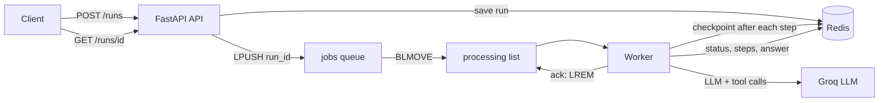

# durable-agent-runtime

Crash-safe execution for LLM agents, built from scratch with FastAPI and Redis. If a worker dies in the middle of a run, the job is not lost and the agent continues from its last completed step instead of starting over.

No agent frameworks are used. The point of the project is to show how durable agent execution works underneath tools like LangGraph's checkpointer.

---

## The problem

An agent run can take anywhere from a few seconds to several minutes: it calls an LLM, runs tools, and calls the LLM again. Running that inside a normal HTTP request causes problems:

- **Timeouts.** Browsers, proxies and hosting platforms often close requests after 30–60 seconds.
- **Lost work.** If the server restarts during a run, everything the agent did is gone, including LLM calls you already paid for.
- **No visibility.** The caller can't see whether the agent is on step 1 or step 9.
- **Duplicate side effects.** Restarting a run from scratch can repeat actions the agent already took.

This project solves these one layer at a time.

---

## Architecture



| Component | File | Role |
|---|---|---|
| API | `main.py` | Accepts runs, returns `202` with a `run_id`, serves run status |
| Store | `store.py` | All Redis access: run records, queue operations, checkpoints |
| Worker | `worker.py` | Takes jobs from the queue, runs the agent, saves progress |
| Agent | `agent.py` | The tool-calling loop. Knows nothing about Redis or HTTP |

### Run lifecycle

```
queued ──► running ──► completed
                  └──► failed
```

---

## Design decisions

### 1. `202 Accepted` and polling instead of a blocking request
`POST /runs` saves the run, puts its ID on a queue and returns immediately with `202 Accepted` and a `run_id`. The client calls `GET /runs/{run_id}` to check progress. The HTTP status code describes the request; the `status` field in the body describes the job. A failed run still returns `200` with `"status": "failed"`, while an unknown ID returns `404`.

### 2. The API and the worker are separate processes
The API only accepts and reports on runs; it never runs the agent. Restarting or redeploying the API does not interrupt runs in progress, and workers can be scaled independently of the API.

### 3. A reliable queue for at-least-once delivery
A plain `BRPOP` removes the job from Redis the moment a worker takes it. If the worker then crashes, the job exists nowhere and the run is stuck in `running` forever.

Instead, the worker uses `BLMOVE`, which **atomically** moves the job ID from `jobs` to a `processing` list. The ID is removed from `processing` (`LREM`, the "ack") only after the run has fully finished. On startup, a worker moves anything left in `processing` back to the front of `jobs`, so jobs from a crashed worker are run again.

Because the move is a single atomic command, there is no moment when the job is in neither list.

### 4. Idempotent processing
At-least-once delivery means a job can occasionally be delivered twice, for example if a worker saves `completed` and then crashes before acking. The worker therefore skips any run whose status is already `completed` or `failed`.

### 5. Step-level checkpoints
After each agent step (one LLM call plus all of its tool results), the worker saves the agent's conversation state (`messages`) and its step log to `checkpoint:<run_id>`. A recovered run loads this checkpoint and resumes the loop from there. The LLM is stateless, so continuing with the same message history is indistinguishable from never having crashed.

Checkpoints are saved only at **clean step boundaries**: never between an assistant message that requests tools and the results of those tools, because the LLM API rejects a conversation where a tool call has no matching result.

The checkpoint is kept separate from the run record (`run:<run_id>`). The run record is what the client sees; the checkpoint is the worker's private state and is deleted once the run finishes.

### 6. The agent stays independent of the infrastructure
`run_agent()` accepts an optional `on_step` callback and calls it after each step. The worker passes a function that saves the checkpoint and updates the run's `steps`, which also lets `GET /runs/{id}` show progress live. The agent itself has no Redis code, so it can be run and tested on its own.

---

## Crash-recovery demo

The worker was killed with Ctrl+C after step 1 of a two-step run, then started again:

```text
$ python worker.py
[worker] recovered 0 unfinished job(s)
[worker] waiting for jobs...
[worker] starting fd2d5394-4736-4eaa-a6e2-5e111476da84 fresh
[worker] checkpoint saved: 1 tool call(s) so far
^C  (worker killed)

$ python worker.py
[worker] recovered 1 unfinished job(s)
[worker] waiting for jobs...
[worker] resuming fd2d5394-4736-4eaa-a6e2-5e111476da84 after 1 tool call(s)
[worker] checkpoint saved: 2 tool call(s) so far
[worker] fd2d5394-4736-4eaa-a6e2-5e111476da84 -> completed
```

- `recovered 1` shows the job was not lost (reliable queue).
- `resuming ... after 1 tool call(s)` followed directly by `2 tool call(s)` shows step 1 was **not** run again (checkpoint).

---

## Running it locally

**Requirements:** Python 3.11+, Redis 6.2+ (for `BLMOVE`), and a [Groq](https://console.groq.com) API key.

```bash
# 1. Start Redis (macOS)
brew install redis
brew services start redis

# 2. Install dependencies
python3 -m venv .venv
source .venv/bin/activate
pip install -r requirements.txt
```

**Terminal 1: the API**
```bash
source .venv/bin/activate
uvicorn main:app --reload
```

**Terminal 2: the worker**
```bash
source .venv/bin/activate
export GROQ_API_KEY=your_key_here
python worker.py
```

Open the interactive API docs at <http://localhost:8000/docs>, or use curl:

```bash
curl -X POST http://localhost:8000/runs \
  -H "Content-Type: application/json" \
  -d '{"question": "What time is it, and what is 23 * 47?"}'
# {"run_id": "...", "status": "queued"}

curl http://localhost:8000/runs/<run_id>
```

### Testing crash recovery yourself

Start the worker with a pause after each checkpoint, so there is time to kill it:

```bash
SIMULATED_DELAY=15 python worker.py
```

Submit a multi-step question, press Ctrl+C after the first `checkpoint saved` line, then start the worker again.

---

## API

| Method | Path | Response |
|---|---|---|
| `GET` | `/health` | `200` `{"status": "ok"}` |
| `POST` | `/runs` | `202` `{"run_id": "...", "status": "queued"}`; `422` if the body is invalid |
| `GET` | `/runs/{run_id}` | `200` with the full run record; `404` if no such run |

Example run record:

```json
{
  "id": "fd2d5394-4736-4eaa-a6e2-5e111476da84",
  "question": "...",
  "status": "completed",
  "answer": "The current time is 13:50, and 23 × 47 = 1081.",
  "steps": [
    {"tool": "get_time", "args": {}, "result": "13:50"},
    {"tool": "calculator", "args": {"expression": "23*47"}, "result": "1081"}
  ],
  "error": null,
  "created_at": "2026-11-19T08:20:00+00:00",
  "finished_at": "2026-11-19T08:20:41+00:00"
}
```

---

## Project structure

```
durable-agent-runtime/
├── main.py           # FastAPI app: POST /runs, GET /runs/{id}
├── worker.py         # Queue consumer: recover, run, checkpoint, ack
├── agent.py          # Tool-calling agent loop with on_step callback
├── store.py          # Redis: runs, reliable queue, checkpoints
├── scripts/          # Manual check scripts used during development
└── requirements.txt
```

---

## Known limitations

These are deliberate scope limits at this stage, not oversights:

- **Recovery assumes a single worker.** On startup a worker requeues everything in `processing`. With several workers, it could requeue a job another live worker is still running. The fix is a per-worker processing list or leases with heartbeats.
- **A tool can run twice in a narrow window.** If a worker crashes after a tool runs but before that step's checkpoint is saved, the tool runs again on resume. This is harmless for read-only tools, but not for actions like sending an email. The planned fix is idempotency keys per tool call, plus human approval before irreversible actions.
- **Redis is the only store.** Redis keeps data in memory; run history should live in a durable database such as Postgres.
- **The demo calculator uses `eval`** with builtins disabled. That is acceptable for a local demo but not safe for untrusted input; a real deployment would use a proper expression parser.
- **The step limit restarts on resume.** `max_steps` counts steps within one worker attempt, not across the whole run.

---

## Roadmap

- [x] Async job API (`202` + polling)
- [x] Separate worker with a Redis queue
- [x] Reliable queue with crash recovery (`BLMOVE` / ack)
- [x] Step-level checkpointing and resume
- [ ] Live progress streaming over Server-Sent Events
- [ ] Postgres for durable run history
- [ ] Tracing: tokens, latency and cost per step
- [ ] Idempotency keys for side-effecting tools
- [ ] Multi-worker safety with leases
